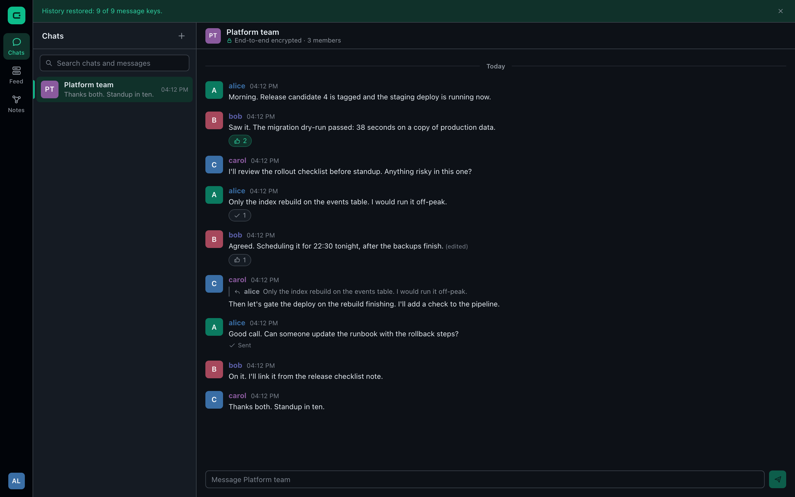
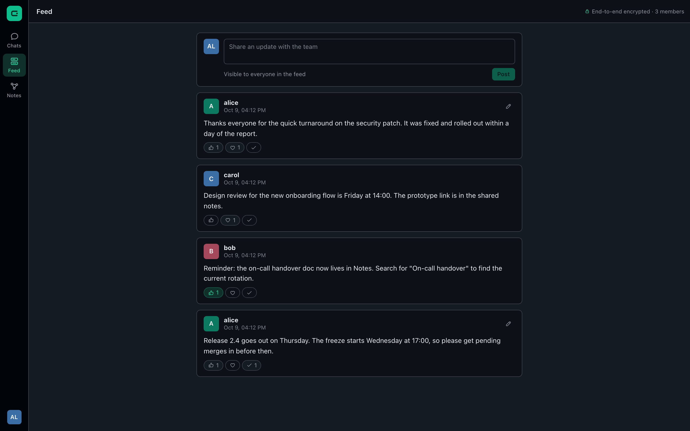
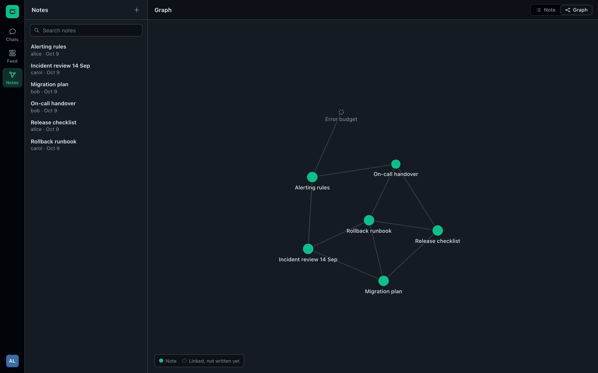
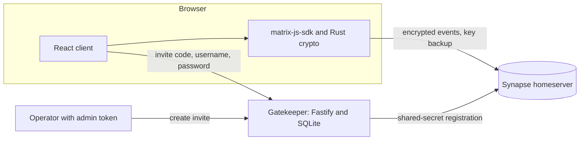

# Enclave

An end-to-end encrypted team messenger on Matrix: encrypted chats, a team feed and linked notes, behind an invite-only signup service.

[](https://github.com/armaghanrashid/enclave-messenger/actions/workflows/ci.yml)

Developed privately since July 2026; this is a reduced public edition.

| Chats | Feed | Notes graph |
| --- | --- | --- |
|  |  |  |

## Why it's interesting

- **The server never sees content.** Every room is Megolm-encrypted in the browser (Rust crypto compiled to WASM). History survives a new browser through a passphrase-protected key backup that the homeserver stores but cannot open.
- **Signup is closed by default.** Synapse has registration disabled; accounts exist only through a small gatekeeper service that issues single-use, expiring, hashed invite codes and talks to the homeserver with a shared-secret admin API.
- **Notes are a graph, not a folder.** Notes are encrypted custom events that link with `[[wikilinks]]`; the client derives backlinks and a force-directed link graph from the room timeline with no server-side index.

## Architecture



| Path | Role |
| --- | --- |
| `client/` | React 19 + Vite app: chats, feed, notes, account and recovery |
| `gatekeeper/` | Fastify service: `POST /invites` (admin token) and `POST /redeem` |
| `dev/` | Local Synapse config template, `start.sh`, and `seed.ts` demo data |

## Quickstart

Requires Node 24 and Python 3.12. Everything runs on localhost; nothing is installed globally.

```bash
git clone https://github.com/armaghanrashid/enclave-messenger.git
cd enclave-messenger
npm ci

# terminal 1: create the venv, generate secrets, start Synapse on localhost:8008
bash dev/start.sh

# terminal 2: invite service on localhost:8090 (reads dev/.secrets)
npm run dev:gatekeeper

# terminal 3: create alice, bob and carol through the gatekeeper, then fill the demo content
npm run seed
npm run dev:client          # http://localhost:5173
```

Sign in as `alice`, `bob` or `carol` with password `enclave-demo-1`. Put `enclave demo recovery` in the optional recovery-passphrase field to restore the seeded history on that browser. These are throwaway local credentials that exist only on your machine.

`bash dev/start.sh reset` deletes the generated secrets, Synapse data and invite database so you can seed again. To mint an invite by hand:

```bash
set -a; . dev/.secrets; set +a
curl -s -X POST localhost:8090/invites -H "Authorization: Bearer $GATEKEEPER_ADMIN_TOKEN"
```

Then use "Join with invite" on the sign-in screen.

## Results

Numbers from one local run on Node 24.14 (Synapse 1.152.1):

| Measure | Result |
| --- | --- |
| Unit tests | 39 passing (client 19, gatekeeper 20) |
| Seed run | 3 accounts, 3 encrypted rooms, 20 encrypted events, 10 unencrypted reactions |
| Backup check | a brand-new device restored 9 of 9 room keys and decrypted 20 of 20 events |
| Client bundle | app JS 1,181.61 kB (343.57 kB gzip), crypto chunk 226.17 kB, WASM 7,805.48 kB (2,133.39 kB gzip), CSS 16.34 kB |

The seed script ends by signing in on a fresh device, restoring from the recovery passphrase and decrypting every event. It exits non-zero if any event stays unreadable, so a green seed run proves the backup path end to end.

## Testing

```bash
npm run lint        # oxlint
npm run typecheck   # tsc for client, gatekeeper and seed
npm test            # vitest, both packages
npm run build       # client bundle and gatekeeper dist/
```

- **Notes:** wikilink parsing (trimming, de-duplication, empty and unterminated links), graph nodes and edges including phantom targets, backlinks, and newest-version-wins collection.
- **Timeline:** feed ordering (newest first, stable on equal timestamps, edits and redactions excluded), edit folding, reaction tallies, message grouping.
- **Gatekeeper:** sha256 hashing and normalisation, expiry boundary, single use, release after a failed registration, rate-limit windows, the registration MAC, and the HTTP routes with a fake homeserver.

CI runs the same four commands on `ubuntu-latest`.

## Design decisions

- **Matrix instead of a custom protocol.** Federation, device keys, backups and a mature E2EE implementation come for free. The cost is a heavy client (an 8 MB WASM crypto module) and protocol quirks, such as the SDK sending reactions unencrypted. Message text and notes are encrypted; reaction keys and redactions are not.
- **Gatekeeper owns signup.** The shared secret never reaches the browser. Codes are about 59 bits, stored only as sha256 digests, claimed with one conditional `UPDATE` so concurrent redemptions cannot both win, and given back if account creation fails (for example, a taken username). Every code failure returns the same message so codes cannot be probed for state.
- **In-memory rate limiting.** A fixed window per client address is enough for a single instance and is trivially testable with an injected clock. Behind a proxy, the address needs Fastify's `trustProxy`; multiple instances would need a shared store.
- **Search is client-side.** The server only holds ciphertext, so chat search runs over the decrypted history the browser has synced.
- **Last writer wins for notes.** A note is identified by its title and the newest event wins; edits are re-sends, so history is free. There is no merge, so two simultaneous edits overwrite each other.
- **Pure timeline logic.** Edits, reactions and feed ordering are plain functions over a small event interface, which keeps the tests fast and free of a homeserver. The trade-off is that there are no browser-level UI tests.
- **Graph layout is computed once.** The force simulation runs to rest before the first render, so the graph appears settled and hover or selection never re-runs physics.

## Licence

Copyright (c) 2026 Muhammad Armaghan Rashid. All rights reserved. Published for viewing only; see [LICENSE](LICENSE).
